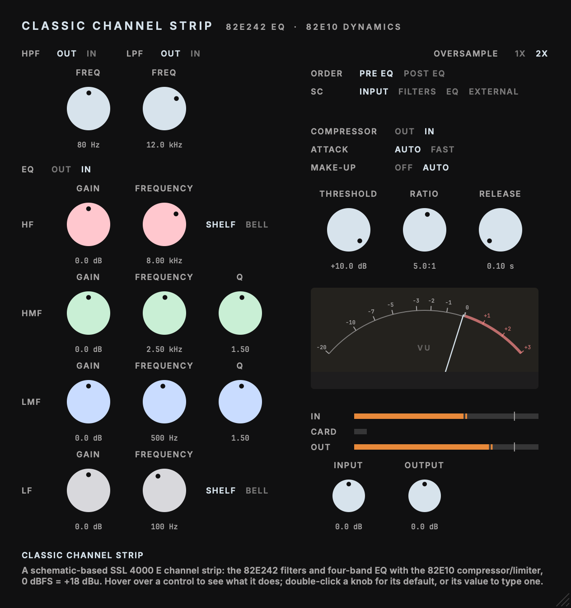

# Classic Channel Strip

Inspired by the SSL 4000 E channel.

Part of the codycodie plug-in collection.

Classic Channel Strip models the 82E242 Rev. 4 filters and four-band EQ with the issue-15 82E10
compressor/limiter. Gate controls remain in saved state for compatibility, but gate attenuation is
permanently bypassed. The model is a linear discrete-time state space extracted from the schematic
netlist (24 states for the 82E242 card), with documented approximations; it is not a component-exact
recreation of a particular console.



This release has a new identity (`com.c0dypeng.classicchannelstrip`, `Cdpg/ClCs`) and can coexist
with the private SSL 4000 EQ plug-in. Existing DAW sessions retain their original plug-in identity
and will not be replaced automatically. Parameter IDs, order, ranges, defaults, and the
`SSL4000EQ` state root remain stable; manually transferred state can be compatible where a host
supports that workflow.

## Downloads

Download the latest builds from [GitHub Releases](https://github.com/chijenpeng/classic-channel-strip/releases/latest).
The macOS package includes universal AU and VST3 builds for Apple Silicon and Intel Macs; it is
ad-hoc signed and not notarized. The Windows package includes an unsigned x64 VST3.

## Controls

| Control | Range | What it controls |
|---|---|---|
| Input | −20 … +20 dB | Gain before the card. 0 dBFS represents +18 dBu at the card. |
| HPF, HPF freq | Out / In; 16–390 Hz | 18 dB/oct high-pass from the 82E242 card. The knob is the −3 dB point. |
| LPF, LPF freq | Out / In; 3.2–22 kHz | 12 dB/oct low-pass from the 82E242 card. The knob is the −3 dB point. |
| HF gain, freq, shape | ±18 dB; 1.3–19 kHz; Shelf / Bell | High-frequency shelf or bell. |
| HMF gain, freq, Q | ±18 dB; 640 Hz–9.4 kHz; 0.5–4.1 | High-mid band. |
| LMF gain, freq, Q | ±18 dB; 140 Hz–2 kHz; 0.5–4.2 | Low-mid band. |
| LF gain, freq, shape | ±18 dB; 37–420 Hz; Shelf / Bell | Low-frequency shelf or bell. |
| EQ | Out / In | Switches the four EQ bands; filters remain active. |
| Output | −20 … +20 dB | Gain after the card. |
| CARD lamp | Indicator | Lights when an op-amp in the card goes past its linear limit (±14.85 V, +4.6 dBFS at the card with the EQ flat; boosts lower it). It holds for about a second and reads the peak reached, in dBFS at the card. Turn Input down to stay clean. |
| Oversampling | 1× / 2× | Processes at host rate or twice that rate. 2× adds 4 samples of latency. |
| Dynamics | Out / In (default In) | Stereo-linked 82E10 compressor/limiter. Bypass is bit-transparent. |
| Comp threshold, ratio | +10 … −20 dB; 1:1 … LIMIT (ratio default 5:1) | Feed-forward compression with the card's diode-network soft knee. |
| Comp attack, release | Auto / Fast; 0.1 … 4 s (release default 0.1 s) | AUTO follows the program-dependent path and reaches 10 dB in about 11 ms; FAST selects the short attack branch, 0.35 ms to 10 dB. Release is the 82E10 release network rebuilt from the drawing. The knob is the 10 % recovery time of the gain reduction after a sustained 10 dB reduction; it spans 0.14 s to 12.6 s, and 0.4, 1, 1.5 and 4 s land within 1 %. Recovery is program-dependent: a short burst recovers faster than sustained compression. |
| Gain reduction meter | Indicator | VU-style needle showing the compressor's gain reduction. It rests at 0 and falls to the left, with 65 ms ballistics chosen for this plug-in, rising and falling alike. It has no numeric readout. |
| Make-up | Off / Auto | Threshold- and ratio-linked automatic make-up. |
| Position | Pre EQ / Post EQ (default Pre EQ) | Places dynamics before or after the filter/EQ card. |
| Sidechain | Input / Filters / EQ / External | Flat key, key filtered by the actual card sections, or the host sidechain input. |

Default order is Input → Dynamics → HPF → LPF → EQ → Output. Post EQ places dynamics after the
card. The FILTERS and EQ sidechain options process a detector copy through the corresponding card
section. External uses the host's optional key input.

## Limits

- Gate controls stay in saved state for compatibility, but gate attenuation is always zero.
- The CARD lamp and the op-amp clipping: below +4.6 dBFS at the card (EQ flat; boosts lower it) the
  card is linear and matches v0.1.0 within 0.05 dB. Above it, clipping is one curve at the section
  outputs, an approximation that overstates the distortion of a narrow, boosted band.
- Below about 5 Hz the card has fewer high-pass poles than the drawing, so a DC offset is blocked at
  the output only.
- Switching Oversampling while audio plays restarts the card at the new rate and can click.
- The release knob's 0.1 s legend sits below the network's reachable range; it behaves as 0.14 s.
- No DAW-host test on an end-user Windows system or an Intel Mac runtime test has been performed.

## Build

Requires CMake 3.22+, Ninja, and Xcode command-line tools on macOS. The project uses JUCE 8.0.9,
from `third_party/JUCE`, `JUCE_SOURCE_DIR`, or the pinned CMake FetchContent fallback.

```sh
cmake -S . -B build -G Ninja -DCMAKE_BUILD_TYPE=Release -DCOPY_PLUGIN_AFTER_BUILD=OFF
cmake --build build --target ClassicChannelStrip_AU ClassicChannelStrip_VST3 classic_channel_test classic_channel_processor_test classic_channel_measure classic_channel_eq_ac classic_channel_snapshot -j2
ctest --test-dir build --output-on-failure
./build/classic_channel_snapshot_artefacts/Release/classic_channel_snapshot docs/editor.png
```

For the universal macOS package, add `-DCMAKE_OSX_ARCHITECTURES="arm64;x86_64"` and run
`tools/package_macos.sh` from a clean, committed tree; it writes
`build-release/dist/classic-channel-strip-<version>-macos-universal.zip` and a `.sha256` companion.

Plug-in copying is disabled by default. Set `-DCOPY_PLUGIN_AFTER_BUILD=ON` only when you want CMake
to copy AU and VST3 bundles to the current user's plug-in folders.

## Validation

Version 0.3.0 on macOS (Apple Silicon): CTest 2/2 (`classic_channel_test`, with its state-space
accuracy, headroom, clipper and release-network checks, and `classic_channel_processor_test`, with the
new-default and old-session checks), universal arm64 + x86_64 AU and VST3 slices, and the 34 parameters
in the same order as v0.1.0. The editor was rendered at its default size and shows the new defaults;
the minimum, maximum and CARD-lamp views are not re-inspected for this release. The Windows package
is built and tested by the repository's release workflow.

## Tests and tools

| Target / command | Coverage |
|---|---|
| `classic_channel_test` | Offline EQ/filter regression (including the state-space engine's response, headroom and clipper checks) and dynamics checks. |
| `classic_channel_processor_test` | Parameter order, old-state migration, mono/stereo and sidechain buses, permanent gate bypass, pre/post routing, oversampling, latency and audio-thread allocations. |
| `classic_channel_measure` | Magnitude response (`fs [id=value ...]`), sine gain/THD (`--sine hz dbfs`) and realtime factor (`--time`) of the card model. Use `--list` for parameter IDs. |
| `classic_channel_eq_ac` | AC analysis used to derive circuit control laws and trim values. |
| `classic_channel_snapshot docs/editor.png` | Editor snapshot; `--size w h` checks scaling, `--overload` lights the CARD lamp, `--curve` measures response, `--render in.wav out.wav` renders audio offline, and `--time [--mono] [--moving] [--rate fs]` times `processBlock`. |

## Circuit model and sources

- **82E242 filters and EQ.** The model follows the Rev. 4 card values with its stated trim choices.
  The filter note documents the HPF/LPF transcription and the unresolved C43 68 nF versus 6.8 nF
  marking. The model uses 6.8 nF, supported by the earlier 82E02 topology and resulting response.
  See [the EQ note](docs/research/ssl-eq.md), [filter note](docs/research/82e242-filters.md), and
  [schematic reference](docs/reference/schematic.md).
- **82E10 dynamics.** The issue-15 service drawing supplies the detector, VCA path, control
  networks, timing, stereo link and metering behavior. The AD536J and DBX 2151 are data-sheet
  macromodels because the drawing treats them as IC blocks. See [the dynamics note](docs/research/82e10-dynamics.md).
- **Engine.** The 82E242 netlist (every resistor, capacitor, pot and switch on the drawing except the
  items listed in the notes) is solved with the trapezoidal rule and pre-warped capacitors. For fixed
  knobs and op-amps below their limit that card is a linear time-invariant system, so on each
  control update the circuit solver extracts its discrete state space (24 states: HPF 4, LPF 2, HF and
  HMF section 9, LMF and LF section 8, output DC blocker 1) and each block runs as small dense
  matrix products. Matrices come from the netlist and the control laws, not from fitted curves.
  Against v0.1.0's engine (our own previous release, which solved the whole netlist every sample with
  nonlinear op-amp devices) the response matches within 0.05 dB from 20 Hz to 20 kHz over 61
  settings at 48 and 96 kHz.
- **Approximations.** Op-amps are ideal gain-1500 sources with no slew rate or bandwidth limit.
  Op-amp clipping (linear to ±14.85 V, soft knee into ±16.5 V) is one curve applied at the section
  outputs rather than inside every op-amp's feedback loop; it differs from v0.1.0 only when the card
  is driven past +4.6 dBFS, and then overstates the distortion of a narrow +18 dB bell. Large coupling
  capacitors (2.2 µF and up, acting below a few Hz) are replaced by shorts, so below about 5 Hz the
  card has fewer high-pass poles than the drawing; the loading of one section on the previous is
  dropped where it did not matter. Switching is instantaneous; part tolerances, temperature drift,
  supply noise and self-noise are not simulated. The equations represent the documented circuit, not
  semiconductor internals. The notes list every approximation and the headroom map (which op-amp
  clips first, and at what input level, for each setting).
- **Sources.** Primary schematic archives are linked from the research notes. Raw schematic scans
  and OCR are kept in the private research source and are not included in this public repository.

The four-band EQ netlist, control laws and trimmers come from the analog-recreation project's
`ssl_e242` module. Trapezoidal integration
and capacitor pre-warping align circuit corners with knob settings across sample rates. At 44.1 / 48
kHz, one step of the integration rule cannot reproduce the top-octave bell and LPF shape as closely;
2× processing brings them closer to the circuit analysis.

## Real-time behavior

There is no latency at 1× and 4 samples at 2×. Both engines are prepared before audio starts.
Oversampling changes are applied on the message thread after audio leaves the idle engine, so
`processBlock` does not construct an engine. Switching while audio plays restarts the card at the
new rate from rest and can produce a small click.

CPU, measured on an Apple M3 (arm64 build, one core, 48 kHz, 512-sample blocks, stereo) with
`classic_channel_snapshot --time`, best of five passes, while other work loaded the machine. The
defaults (dynamics in at 5:1) ran at about 90x real time at 2x and about 200x at 1x. With dynamics
out they ran at about 270x at 2x and 850x at 1x. With both filters, all four bands and the dynamics
in, about 95x at 2x and 200x at 1x. With every card control moving all the time (`--moving`, 2x,
defaults) about 58x, because the state space is re-extracted every 32 samples. The dynamics now cost
more than in v0.2.0: the same dynamics-in configuration ran at about 135x at 2x there, so the rebuilt
release network uses roughly 40 % more CPU per sample; the card is unchanged. Actual use depends on
the computer, sample rate and settings.
The processor regression test checks that `processBlock` makes zero allocations with controls still,
moving, oversized blocks, and during an oversampling change.

## Layout

| Path | Contents |
|---|---|
| `Source/dsp/` | The card's netlist, state-space extraction and runner (`StateSpaceBlock`), the 82E10 model and the modified-nodal solver; no JUCE dependency. |
| `Source/PluginProcessor.{h,cpp}` | Processor, stable parameter/state schema, oversampling and meters. |
| `Source/PluginEditor.{h,cpp}` | Scalable editor, real controls and meters, and hover help. |
| `Source/ResponseAnalyser.{h,cpp}` | Offline response measurement for the snapshot utility. |
| `tests/` | Circuit, processor, measurement and snapshot programs. |
| `tools/ssl_eq_ac.cpp` | Source for the `classic_channel_eq_ac` calculation target. |
| `docs/research/` | Maintained circuit research and approximation notes. |
| `Resources/fonts/` | Embedded Inter and JetBrains Mono fonts with SIL Open Font License notices. |

See [THIRD_PARTY_NOTICES.md](THIRD_PARTY_NOTICES.md) for JUCE, font and SDK notices.
